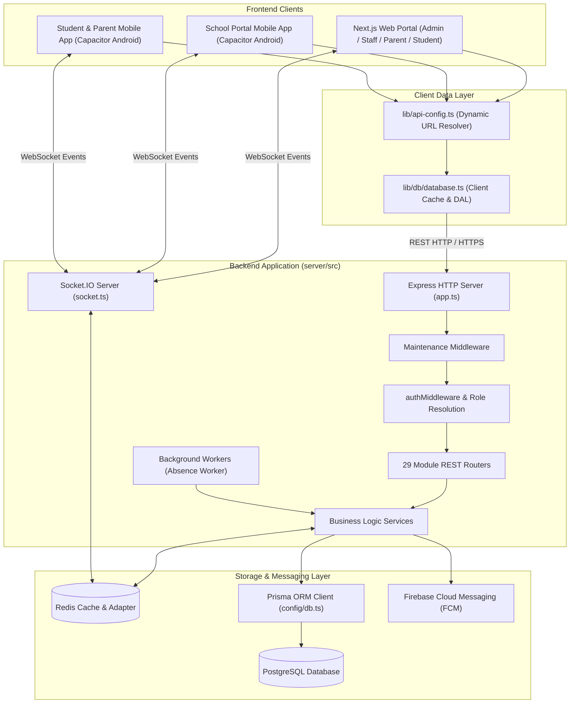
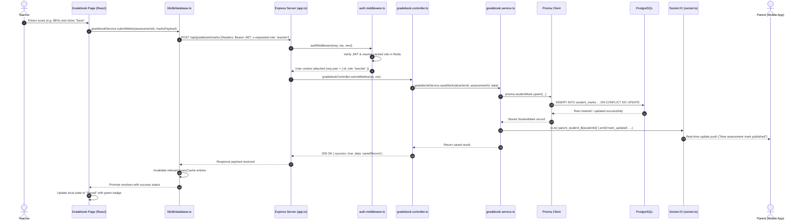
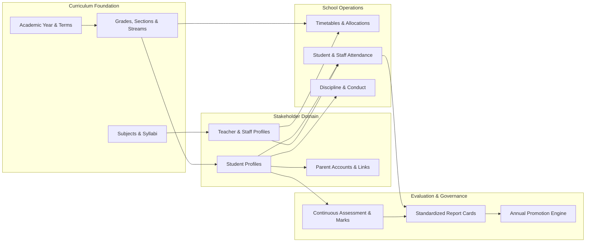

# Bright Path School Management System — Architecture & Engineering Documentation

**Document Version:** 1.0.0  
**Target Audience:** Full-Stack Engineers, DevOps, System Architects  
**Repository:** `zetimer` (Bright Path)  
**Date of Analysis:** October 2026  

---

## Executive Summary

**Bright Path** is a multi-tenant-capable, role-based school management platform engineered to support academic administration, staff biometric and geofenced attendance tracking, grading and assessment governance, real-time communications, student discipline oversight, and parental engagement.

The system is deployed as a hybrid multi-client architecture:
1. **Next.js Web Applications**: A responsive management console for administrators, academic heads, teachers, HR, librarians, transport coordinators, and registrars.
2. **Capacitor Mobile Applications (Android)**: Two compiled APK packages (`BrightPath-School-Portal.apk` and `BrightPath-Student-Parent-Portal.apk`) targeting mobile devices with push notifications, camera biometric capture, and native hardware integration.
3. **Node.js / Express Backend**: A centralized REST API and WebSocket engine coupled with Redis for session/role caching and Socket.IO cluster synchronization.
4. **PostgreSQL Database via Prisma ORM**: A structured relational schema containing 60+ models governing organizational hierarchies, curriculum structures, assessment schemes, attendance logs, and communication channels.

---

## Table of Contents

1. [Project Directory & File Structure](#1-project-directory--file-structure)
2. [Module & Directory Responsibilities](#2-module--directory-responsibilities)
3. [Technology Stack Matrix](#3-technology-stack-matrix)
4. [System Architecture Breakdown](#4-system-architecture-breakdown)
   - [4.1 Frontend Architecture](#41-frontend-architecture)
   - [4.2 Backend & Service Architecture](#42-backend--service-architecture)
   - [4.3 Database Architecture & Data Modeling](#43-database-architecture--data-modeling)
   - [4.4 Authentication, Role Resolution & Security](#44-authentication-role-resolution--security)
   - [4.5 REST & WebSocket API Architecture](#45-rest--websocket-api-architecture)
5. [End-to-End Data Flow](#5-end-to-end-data-flow)
6. [Domain Interconnections & Module Dependencies](#6-domain-interconnections--module-dependencies)
7. [Verified Observations & Optimization Opportunities](#7-verified-observations--optimization-opportunities)

---

## 1. Project Directory & File Structure

```text
zetimer/
├── .agents/                        # IDE agent workflows and skills
├── android/                        # Android Studio native project generated by Capacitor
├── app/                            # Primary Next.js App Router (Web platform & administration)
│   ├── activate/                   # Account self-activation (student & parent)
│   ├── api/                        # Next.js route handlers (password reset token, server time)
│   ├── forgot-password/            # Password recovery flow
│   ├── parent/                     # Parent monitoring views
│   ├── portal/                     # Unified portal redirector
│   ├── reset-password/             # Password reset submission page
│   ├── school/                     # Multi-role school management consoles:
│   │   ├── academic-head/          # Academic Head reports, assessment governance
│   │   ├── admin/                  # School Admin management (students, staff, timetables, etc.)
│   │   ├── discipline-officer/     # Discipline tracking & incident follow-ups
│   │   ├── librarian/              # Library catalog & book borrowing
│   │   ├── registrar/              # Admissions & student intake
│   │   ├── staff-hr/               # HR, staff records & scheduling
│   │   ├── teacher/                # Teacher dashboard, gradebook & attendance
│   │   └── transport/              # Bus fleet, routes & student allocations
│   ├── student/                    # Student-specific dashboard
│   ├── globals.css                 # Global Tailwind CSS and design tokens
│   └── layout.tsx                  # Root HTML shell & global context providers
├── apps/                           # Monorepo workspaces for dedicated native APK targets
│   ├── school-portal/              # Next.js workspace compiled for School Staff APK
│   │   ├── app/                    # App Router tailored for school staff
│   │   ├── next.config.mjs         # School portal Next.js configuration
│   │   └── package.json            # School portal dependencies
│   └── student-parent-portal/      # Next.js workspace compiled for Student & Parent APK
│       ├── app/                    # App Router tailored for students and parents
│       ├── next.config.mjs         # Student/parent portal Next.js configuration
│       └── package.json            # Student/parent portal dependencies
├── components/                     # Reusable React UI component library
│   ├── auth/                       # Login dialogs, session expired modals
│   ├── capacitor-initializer.tsx   # Native mobile push notifications & hardware hooks
│   ├── discipline/                 # Incident management & follow-up dialogs
│   ├── layout/                     # Headers, sidebars, navigations
│   ├── messaging/                  # Real-time chat, channels & WebRTC call UI
│   ├── parent/                     # Parent-specific dashboards & student overview cards
│   ├── providers/                  # Query cache, theme, auth & notification providers
│   ├── school/                     # Core school management UI views:
│   │   ├── academic-structure-tab.tsx # Grade, section & stream configurations
│   │   ├── admin-client-layout.tsx    # Admin navigation shell
│   │   ├── attendance-tracking.tsx    # Student QR & manual attendance
│   │   ├── face-verification-camera.tsx # Biometric face-api.js camera recognition
│   │   ├── geofence-map-picker.tsx    # Leaflet GPS geofence boundary configuration
│   │   ├── staff-attendance.tsx       # Staff biometric clock-in / out
│   │   ├── student-management.tsx     # Student database & admissions
│   │   ├── teacher-portal.tsx         # Teacher gradebooks, lessons & marks
│   │   └── timetable-management.tsx   # Automatic & manual timetable scheduler
│   ├── student/                    # Student dashboard, homework & grade views
│   └── ui/                         # Base primitive components (Radix UI + Tailwind)
├── docs/                           # Technical documentation and guides
│   ├── mobile-testing.md           # Mobile testing instructions
│   ├── offline-support.md          # Offline synchronization guidelines
│   └── system-architecture.md      # This document
├── lib/                            # Shared client-side business logic & services
│   ├── api-config.ts               # Dynamic URL resolver (Web vs Android Capacitor vs Render)
│   ├── auth/                       # JWT token management, refresh logic & storage
│   ├── context/                    # React Contexts (Auth, School, AcademicYear, etc.)
│   ├── db/                         # Client-side data access layer & sync queues
│   │   ├── database.ts             # Gateway class with caching & query deduplication
│   │   └── methods/                # Endpoint callers (students, attendance, calls, etc.)
│   ├── gradebook-service.ts        # Client-side assessment & report card generator
│   └── utils/                      # Fetch timeout wrapper, notification toasts, formatting
├── packages/                       # Shared internal packages
│   ├── api-client/                 # Unified HTTP client exports
│   ├── auth/                       # Shared auth utilities
│   ├── config/                     # Shared environment configurations
│   ├── types/                      # Shared TypeScript definitions
│   ├── ui/                         # Shared design tokens & components
│   └── utils/                      # Shared helper functions
├── public/                         # Static assets, logos, and face recognition model weights
├── scripts/                        # Automation & deployment scripts
│   ├── build-apk.js                # Capacitor Android APK compiler script
│   └── fix-turbo.ps1               # Next.js Turbo cache maintenance script
├── server/                         # Express.js REST API & WebSocket Backend
│   ├── prisma/
│   │   ├── migrations/             # PostgreSQL database migration history
│   │   └── schema.prisma           # Complete database model definitions (60+ models)
│   ├── src/
│   │   ├── config/                 # Database connection pools (`db.ts`)
│   │   ├── controllers/            # Request handlers & response validators
│   │   ├── middleware/             # Auth JWT, Role Guards, Rate Limiting, Maintenance
│   │   ├── routes/                 # REST routing declarations (29 route modules)
│   │   ├── services/               # Core business logic & database queries
│   │   ├── app.ts                  # Express server definition & middleware setup
│   │   ├── redis.ts                # Redis client connection & caching helpers
│   │   ├── server.ts               # HTTP bootstrap, background jobs & socket attach
│   │   └── socket.ts               # Socket.IO real-time chat & WebRTC signaling
│   ├── package.json                # Backend dependencies & Prisma commands
│   └── tsconfig.json               # Backend TypeScript configuration
├── capacitor.config.ts             # Capacitor mobile configuration (appId, webDir)
├── next.config.mjs                 # Root Next.js configuration & image domains
├── package.json                    # Monorepo workspaces & build orchestration
└── tsconfig.json                   # Root TypeScript project config
```

---

## 2. Module & Directory Responsibilities

### 2.1 Workspace Root
- **`package.json`**: Orchestrates monorepo workspaces (`apps/*`, `packages/*`), development servers (`npm run dev:school`, `npm run dev:portal`, `npm run dev:server`), and APK compilation scripts.
- **`capacitor.config.ts`**: Dynamically switches the application ID and display name based on `APP_TARGET`:
  - `school` $\rightarrow$ `com.brightpath.school` ("Bright Path School Portal")
  - `portal` $\rightarrow$ `com.brightpath.portal` ("Bright Path Student & Parent")

### 2.2 Frontend Applications
- **`app/`**: Root App Router serving web users. It implements role-based navigation shells (`admin-client-layout.tsx`, `teacher-client-layout.tsx`, `parent-client-layout.tsx`) that conditionally expose management views depending on the active role.
- **`apps/school-portal/`**: Dedicated sub-application packaged into the staff mobile APK. Built with static export (`next build --webpack`), generating assets into `out/` which Capacitor embeds into the Android webview.
- **`apps/student-parent-portal/`**: Dedicated sub-application packaged into the student/parent mobile APK.

### 2.3 Shared Client Libraries (`lib/`)
- **`lib/api-config.ts`**: Resolves the backend base URL dynamically:
  - On Capacitor native mobile $\rightarrow$ Uses `process.env.NEXT_PUBLIC_API_URL` or fallback cloud backend (`https://bright-8uji.onrender.com`).
  - On local development web browsers $\rightarrow$ Automatically targets `http://${window.location.hostname}:5000` to support LAN testing on physical devices.
- **`lib/db/database.ts`**: Client-side Data Access Layer (DAL). Implements an in-memory cache (`queryCache`) with TTLs and pattern invalidation (e.g. invalidating `/^students_/` upon adding a student) to prevent redundant HTTP roundtrips.
- **`lib/context/`**: React context providers for application-wide reactive state:
  - `auth-context.tsx`: Active user identity, role switching, token storage.
  - `academic-year-context.tsx`: Currently active academic year and terms.
  - `school-context.tsx`: School profile and system settings.
  - `unread-context.tsx`: Live counts of unread messages and notifications.

### 2.4 Backend Application (`server/`)
- **`server/src/server.ts`**: Entry point that starts the Node.js HTTP listener on port 5000, connects Redis, initializes Socket.IO with Redis adapter, and runs a recurring background worker every 5 minutes (`processAutomaticStaffAbsences`).
- **`server/src/app.ts`**: Mounts Express middleware (CORS, cookies, compression, body parsing up to 100MB for biometric/file uploads, maintenance mode check) and routes traffic to 29 modular API routers under `/api/*`.
- **`server/src/routes/`**: Contains endpoint definitions mapped to HTTP methods (`student.routes.ts`, `attendance.routes.ts`, `gradebook.routes.ts`, etc.).
- **`server/src/controllers/`**: Validates request parameters and delegates business execution to services.
- **`server/src/services/`**: Encapsulates data validation, calculation algorithms (such as GPA calculation and promotion criteria), and database queries using Prisma.
- **`server/src/socket.ts`**: Implements real-time events for instant messaging, group channels, delivery receipts, audio/video call signaling (WebRTC offer/answer/ICE candidates), and live notifications.

---

## 3. Technology Stack Matrix

| Layer | Technology | Primary Role / Package |
| :--- | :--- | :--- |
| **Frontend Framework** | Next.js 16.2 (App Router) | Server-Side Rendering (web) and Static Export (Capacitor mobile) |
| **UI Library** | React 19.2 | Declarative component architecture |
| **Language** | TypeScript 5 | End-to-end static typing across frontend and backend |
| **Styling & Design** | Tailwind CSS 4 + Radix UI | Modern responsive UI, accessible design primitives |
| **Data Visualization** | Recharts 2.15 | Attendance trends, grade distributions, mastery tier charts |
| **Biometric Face Capture**| `@vladmandic/face-api` 1.7 | On-device neural network face detection and verification |
| **Geofencing & Maps** | Leaflet 1.9 + React-Leaflet | Campus geographic perimeter mapping and staff clock-in bounds |
| **Native Mobile Bridge** | Capacitor 8 | Native Android packaging, Camera, Push Notifications, Device API |
| **Backend Framework** | Express.js 4.18 (Node.js 20+) | High-throughput REST API server |
| **Real-Time Engine** | Socket.IO 4.8 | Real-time chat messaging, presence, and WebRTC call signaling |
| **Cache & Pub/Sub** | Redis 6+ (`ioredis`) | Role permission caching, Socket.IO multi-instance adapter |
| **Database ORM** | Prisma ORM 5.22 | Type-safe query builder, relation mapping, and migrations |
| **Database Engine** | PostgreSQL | Relational ACID-compliant data storage |
| **Push Notifications** | Firebase Admin SDK 14.0 | FCM push notifications to native Android devices |
| **Security & Auth** | JWT (`jsonwebtoken`) + `bcryptjs` | Stateless token authentication, role validation, password hashing |

---

## 4. System Architecture Breakdown

### 4.1 High-Level Architecture Diagram



### 4.2 Frontend Architecture
The frontend utilizes Next.js App Router with client-side state optimization:
- **Role Isolation via Dynamic Layouts**: Dedicated client layouts (e.g., `admin-client-layout.tsx`, `academic-head-client-layout.tsx`) wrap individual sections. They verify user permissions, render responsive role-specific sidebars, and prevent unauthorized route views.
- **Client-Side Data Access Layer (DAL)**: UI components do not invoke raw `fetch` directly. Instead, they interact with `gradebookService`, `disciplineService`, or `Database` (`lib/db/database.ts`), which automatically handle:
  - Authorization header injection (`Bearer <token>`).
  - Active role context forwarding (`x-requested-role`).
  - Cache deduplication via `queryCache`.
  - Offline sync queuing (`sync-queue.ts`).

### 4.3 Backend & Service Architecture
The backend is structured into four distinct layers:
1. **Routing (`server/src/routes/`)**: Maps URI paths to controller methods and applies route guards such as `featureGuard('advanced_analytics')` or `requireRole(['admin', 'academic_head'])`.
2. **Controllers (`server/src/controllers/`)**: Sanitizes request bodies, query strings, and headers, translating service outcomes into structured JSON envelopes:
   ```json
   {
     "success": true,
     "data": { ... },
     "message": "Optional feedback"
   }
   ```
3. **Services (`server/src/services/`)**: Implements complex business rules:
   - `staff-attendance.service.ts`: Computes staff punctuality against geofenced coordinates and auto-marks unexcused absences.
   - `assessment-report.service.ts`: Aggregates academic grades, builds gradebook league tables, and generates standardized report card summaries.
   - `promotion.service.ts`: Evaluates end-of-year student promotion criteria based on policy passing marks and minimum attendance percentages.
4. **Data Access (`server/src/config/db.ts`)**: Singleton Prisma client connected to PostgreSQL.

### 4.4 Database Architecture & Data Modeling
The database contains over 60 relational models defined in `server/prisma/schema.prisma`. Major entity groupings include:

- **Institutional Structure**:
  - `AcademicYear` $\rightarrow$ `AcademicTerm`
  - `Grade` $\rightarrow$ `Section` & `Stream`
  - `Subject` $\rightarrow$ `GradeSubject`
  - `Classroom`
- **User & Role Management**:
  - `User`: Central identity record holding email, phone, hashed password, active role, profile photo, and push token.
  - `Teacher` & `TeacherAssignment`: Maps teachers to specific Grade-Section-Subject combinations.
  - `SystemRole`: Role definitions and permission matrices.
  - `ParentStudentLink`: Maps parent accounts to one or more children.
- **Attendance & Biometrics**:
  - `Attendance`: Student daily/session attendance with status (`PRESENT`, `ABSENT`, `LATE`, `EXCUSED`).
  - `StaffFaceEnrollment` & `StaffAttendance`: Biometric descriptor embeddings and check-in logs with GPS coordinates.
- **Academics & Gradebook**:
  - `GradingScale`: Letter bands, min/max ranges, GPA points.
  - `AssessmentType` & `AssessmentWeightScheme`: Configuration of formative/summative weights.
  - `Assessment` $\rightarrow$ `StudentMark` $\rightarrow$ `MarkAuditLog`: Immutable assessment scores with edit audit trails.
  - `ReportCard` & `ReportCardSubjectScore`: Final compiled term/annual report cards.
- **Operations & Communications**:
  - `Timetable`, `TimetablePeriod`, `TimetableSlot`: School weekly schedule matrix.
  - `StudentDiscipline`, `DisciplineActionConfig`, `DisciplineFollowUp`: Behavioral records.
  - `Conversation`, `ConversationMember`, `Message`: Real-time chat.
  - `CallSession`, `CallParticipant`, `CallHistory`: WebRTC audio/video call sessions.

### 4.5 Authentication, Role Resolution & Security
1. **Token Issuance**: Users authenticate via `/api/auth/login`, `/api/parent/login`, or `/api/student/login`. On validation, the server generates a signed JWT containing `id`, `email`, and base `role`.
2. **Multi-Role Resolution**:
   - In institutional settings, an individual may act as both a Teacher and a Parent, or an Admin and a Teacher.
   - The client passes an `x-requested-role` header (or route-based inference in `auth.middleware.ts`).
   - `resolveRoleInSchool` checks whether the user possesses the requested capability.
   - The resolved role is cached in Redis under `role:<userId>:<requestedRole>` with a 300-second TTL to avoid database lookups on every HTTP call.
3. **Public Route Exclusions**:
   - Specified endpoints (e.g. `/api/auth/*`, `/api/parent/login`, `/api/student/*`, `/health`) bypass authentication guards.

---

## 5. End-to-End Data Flow

The following sequence diagram details an end-to-end data transaction—recording an assessment mark in the Gradebook:



---

## 6. Domain Interconnections & Module Dependencies



### Key Functional Couplings:
1. **Attendance $\rightarrow$ Academic Report Cards**: The report card engine (`assessment-report.service.ts`) queries the `Attendance` table to aggregate total days present, absences, and unexcused lates directly onto the official student terminal report.
2. **Timetable $\rightarrow$ Teacher Attendance Sheets**: The teacher's daily class roster automatically filters according to the active `TimetableSlot` matching the current day of the week and period schedule.
3. **Continuous Assessment $\rightarrow$ Promotion**: The promotion service checks cumulative weighted scores across all terms against `GradingScale` passing minimums to automatically mark students as `PROMOTED`, `RETAINED`, or `CONDITIONAL`.
4. **Real-time Signaling $\rightarrow$ Native Push**: When an instant message or call is initiated via Socket.IO, if the recipient is not connected to a live socket, the server automatically issues an FCM push notification through Firebase Admin to awaken the native Android app.

---

## 7. Verified Observations & Optimization Opportunities

### 7.1 Architecture Findings
- **Parallel Source Trees**: The repository includes both the root `app/` folder and `apps/school-portal/app/`. While `apps/school-portal` is intended for mobile packaging, maintaining dual trees creates a risk of drift during UI updates.
  - *Recommendation*: Unify page components into a shared package (e.g. `packages/ui` or `packages/pages`), having both the root web app and `apps/school-portal` consume the same source files.
- **Dynamic Network Configuration**: `lib/api-config.ts` handles the transition between local development (LAN IP auto-detection) and native APK execution smoothly. However, the hardcoded fallback URL (`https://bright-8uji.onrender.com`) should strictly be governed by environment variables in production CI/CD pipelines.
- **Resilient Redis Fallback**: In `server/src/server.ts`, if Redis is unreachable, the system catches the error, logs a warning, and operates in single-instance socket mode. This makes local developer onboarding easy without requiring a running Redis container.

### 7.2 Database & Query Scalability
- **Relational Integrity**: The Prisma schema employs proper foreign key cascading (`onDelete: Cascade` / `SetNull`) and comprehensive multi-column indexes (such as `@@unique([studentId, routeId])` and `@@index([academicYearId, gradeId])`).
- **Heavy Historical Reporting**: Academic aggregations calculating cross-term averages across entire grade levels should leverage PostgreSQL materialized views or cache tables to maintain sub-second response times as historical data grows.

---

## Conclusion
The **Bright Path School Management System** exhibits a clean, production-grade full-stack architecture. The division of labor between Next.js, Express, Redis, Prisma, and Capacitor provides a scalable foundation for both web administration and mobile student/parent engagement.
